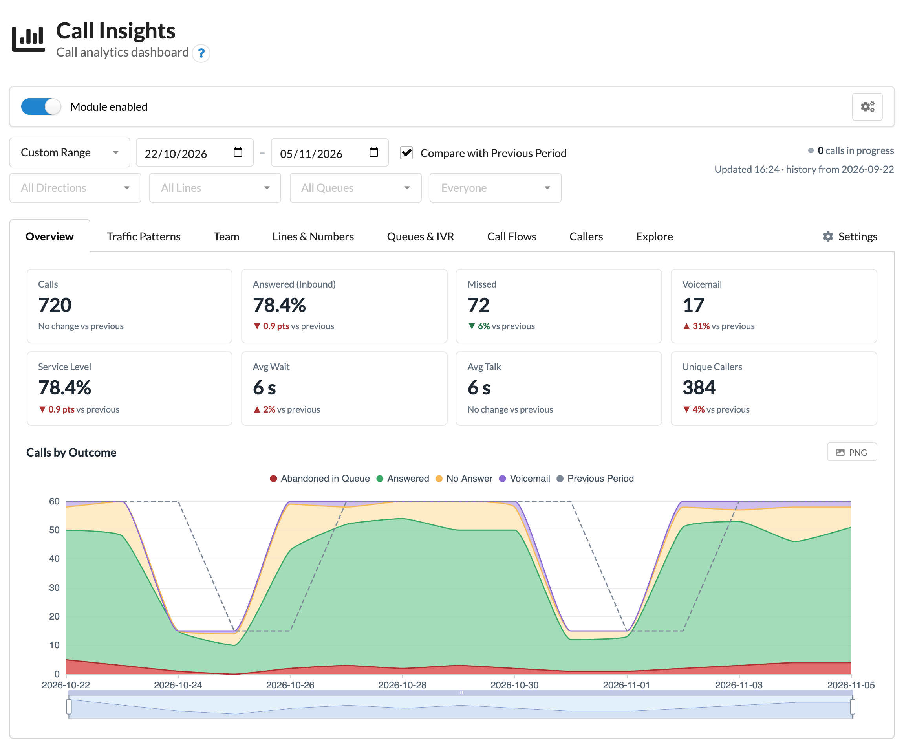
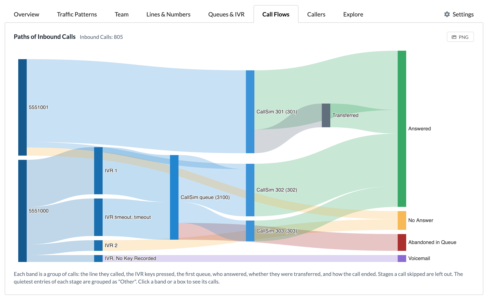
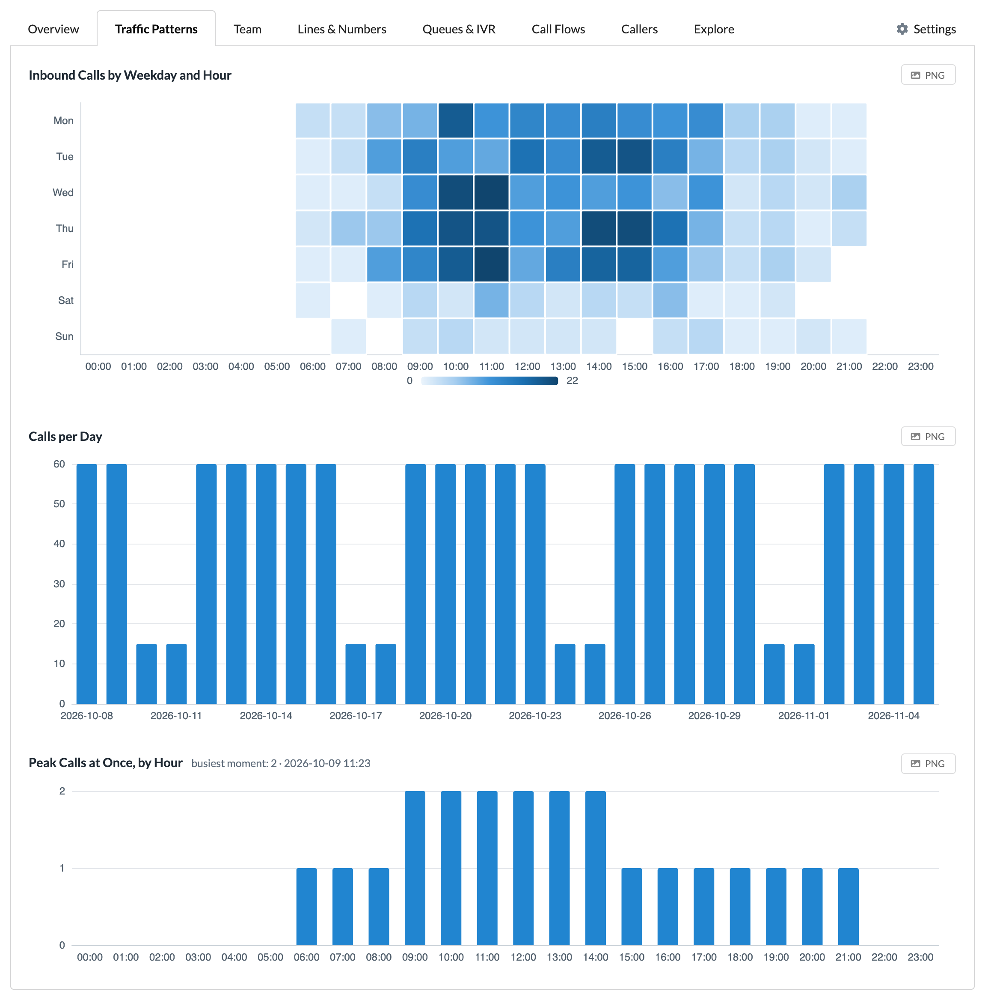
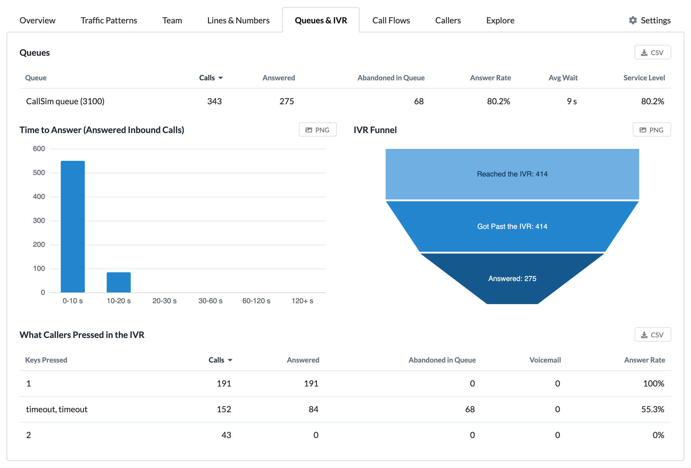
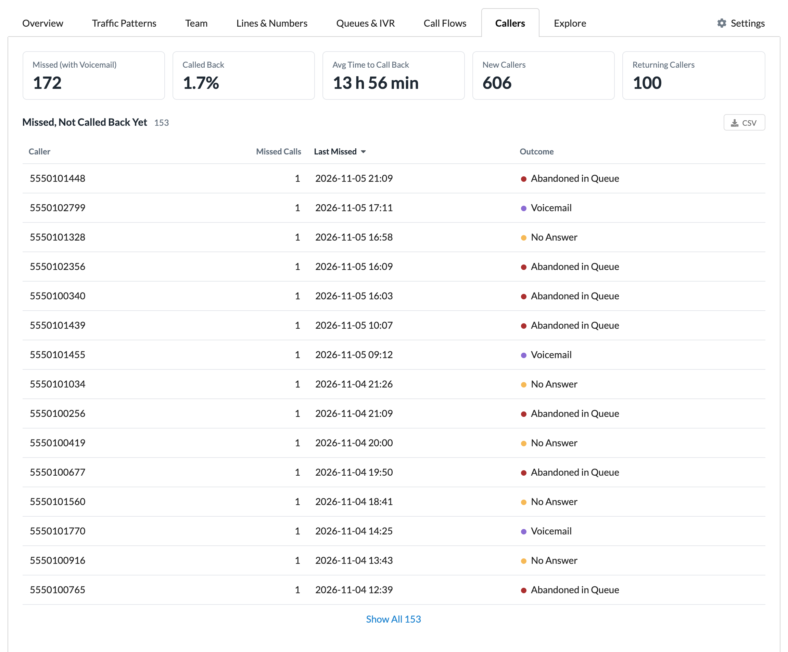
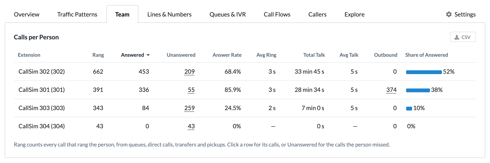
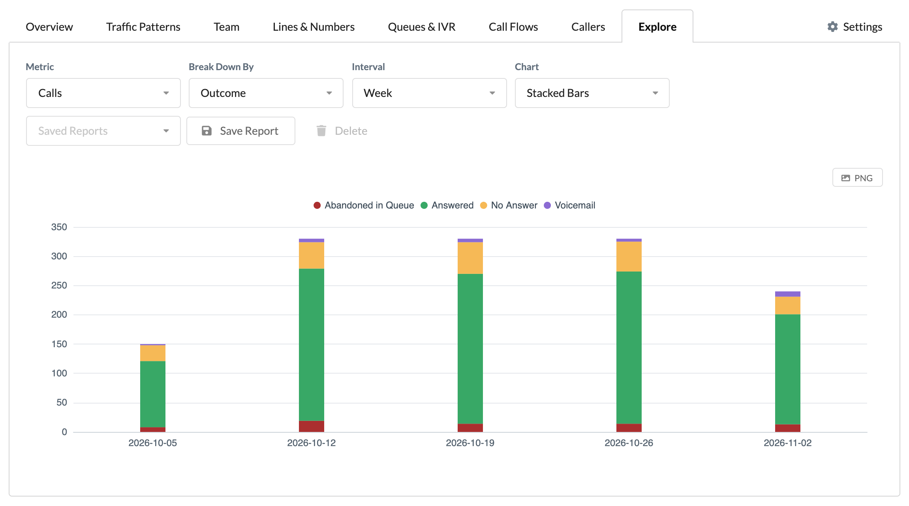
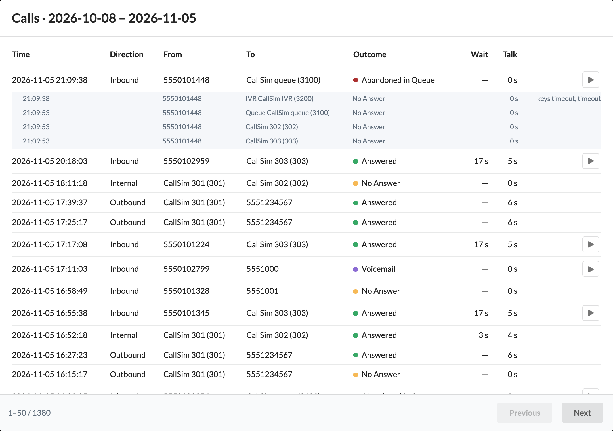

# Call Insights for MikoPBX

**Module ID:** `ModuleCallInsights`

A MikoPBX extension module that adds a call analytics dashboard to the admin cabinet. It shows how many calls you get and when, who answers them, where callers wait or give up, and who is still waiting for a call back, from the call history MikoPBX already keeps. It keeps a small, rebuildable per-call index derived from the call detail records (CDR), plus long-term daily totals, and charts them with Apache ECharts.

> Download the latest version from the [Releases page](https://github.com/eneuen/ModuleCallInsights/releases). What changed in each version is in [CHANGELOG.md](CHANGELOG.md).

## Features

- **Pages:** Overview, Traffic patterns, Team, Lines & numbers, Queues & IVR, Call flows (a Sankey of inbound call paths), and Callers (missed calls, callbacks and the "not called back yet" list).
- **Explore:** any metric by any breakdown, over time, as a line, bar, stacked, pie or table, saved as a named report or shared as a URL.
- **Drill-down** from any chart, tile or row to the matching calls and their legs, with recording playback.
- **Exports:** CSV of any table, PNG of any chart.
- **Settings:** service level target, callback window and history indexing speed; a Rebuild button; download and import of the daily totals as a backup.
- **Languages:** English and Russian, following the admin cabinet's language.

## Screenshots

The screenshots show a test PBX with simulated calls.

<table>
  <tr>
    <td width="50%" valign="top">
      
       <b>Call Flows.</b> The path inbound calls take, from the line called through the IVR, queue and person to how the call ended.
    </td>
    <td width="50%" valign="top">
      
       <b>Traffic Patterns.</b> When calls arrive by weekday and hour, calls per day, and the most calls in progress at once.
    </td>
  </tr>
  <tr>
    <td width="50%" valign="top">
      
       <b>Queues & IVR.</b> Answer and abandon figures per queue, time to answer, the IVR funnel and the keys callers pressed.
    </td>
    <td width="50%" valign="top">
      
       <b>Callers.</b> How many missed callers were called back, how fast, and who is still waiting for a call back.
    </td>
  </tr>
  <tr>
    <td width="50%" valign="top">
      
       <b>Team.</b> Customer calls that rang each person, how many they answered, ring and talk time, and their share of answered calls, with calls between colleagues counted separately.
    </td>
    <td width="50%" valign="top">
      
       <b>Explore.</b> Any metric by any breakdown and interval, as a chart or table, saved as a report or shared as a URL.
    </td>
  </tr>
  <tr>
    <td colspan="2" valign="top">
      
       <b>Drill-down.</b> Clicking any chart, card or row opens the matching calls. Each call opens into its legs (IVR, queue, the people it rang), with keys pressed and a play button for recordings.
    </td>
  </tr>
</table>

## Requirements

- MikoPBX 2026.6.34 or later
- An admin account on the PBX: the dashboard is shown to admins only.

## Installing

1. Download `ModuleCallInsights-<version>.zip` and its `.sha256` file from this repository's **Releases** page. Use that zip: the "Source code" downloads GitHub adds to each release are for developers and can't be installed.
2. Check the download against its checksum, for example with `shasum -a 256 -c ModuleCallInsights-<version>.zip.sha256` (macOS or Linux).
3. In the MikoPBX admin cabinet, open **Modules**, upload the zip, then enable the module.

Call Insights appears in the sidebar for admins. On first start it indexes the existing call history in the background; the dashboard says so until it has finished.

**Updating:** upload the newer zip on the same page. The call index, daily totals, settings and saved reports are kept.

**Uninstalling:** disable and delete the module on the same page. Unless you choose to keep its settings, its database (call index, daily totals, saved reports) is deleted with it.

## How it works

- **MikoPBX's call history stays the source of truth.** A background worker reads the call detail records (CDR) the PBX already keeps, over a read-only connection, and keeps one summary row per call in the module's own database. That index can be rebuilt from the call history at any time.
- **Daily totals** keep long-term trends after the PBX deletes old call records. They hold counts and sums only, never caller numbers.
- **Admins only.** Every request is checked for the `admins` role by the module itself, on top of MikoPBX's own checks.
- **Network storage is supported.** When the call history is on NFS or SMB storage, SQLite can't use its faster write-ahead logging (WAL) mode, so the module detects the filesystem and keeps its reads and writes short there.
- **Nothing leaves the PBX.** The module makes no outside connections; the charts and their library are served from the PBX itself.

## Privacy and data

- Caller numbers in the call index follow the PBX's own retention period, the **Call recording storage period** on the **Storage** page, which also sets how long MikoPBX keeps its call history. When MikoPBX deletes a day of calls, the module removes that day from its index within a day (its upkeep runs nightly).
- The daily totals are kept beyond that, so long-term trends survive, but they hold no phone numbers.
- Recordings stay where MikoPBX keeps them. The module doesn't copy them; playback uses the PBX's own short-lived links, fetched only when you press play.
- Everything the module stores is in its own database on the PBX, deleted when you uninstall it without keeping settings.

## Tested limits

Benchmarked for a small office: 500 calls a day for a year, on 2 CPUs. The first back-fill of a year's history takes about 2 minutes, the PBX's own call-history writes waited at most 69 ms meanwhile, and every dashboard query took under 0.1 s. A 5,000-a-day year still meets every target. Details and method: [tools/benchmark](tools/benchmark/README.md).

## Security

See [SECURITY.md](SECURITY.md) for how to report a vulnerability.

The checks run before a release (access by every kind of user, hostile caller IDs, fuzzing, cross-site writes, the read-only call history, a strict content security policy and static analysis) and their results are listed in [CHANGELOG.md](CHANGELOG.md).

## Contributing

Bug reports, ideas and pull requests are welcome. [CONTRIBUTING.md](CONTRIBUTING.md) explains how to run the tests and checks, how the code is laid out, and how releases are made.

## License

GPL-3.0-or-later. See [LICENSE](LICENSE).
